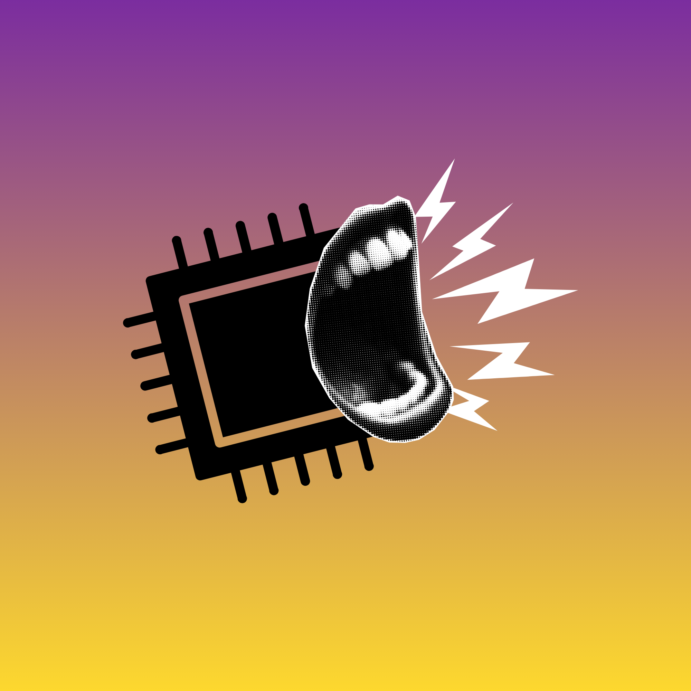
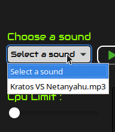
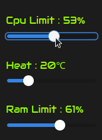
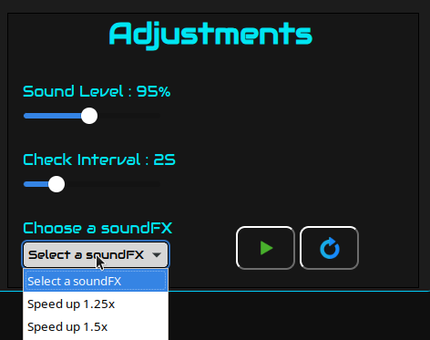
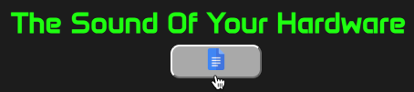
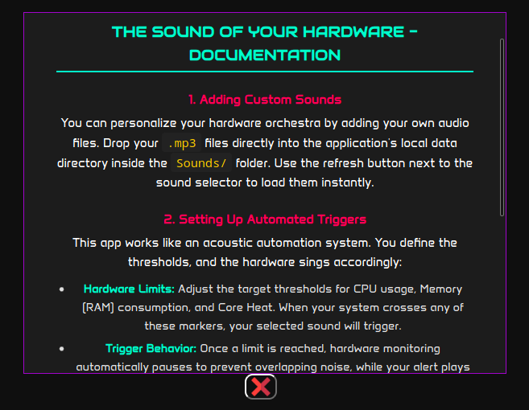

# TheSoundOfYourHardware 0.1.0 FULL
[](https://www.rust-lang.org/)
[](https://tauri.app/)
[](https://www.typescriptlang.org/)




## What is TheSoundOfYourHardware?

When your hardware hits the limits you set (CPU usage, memory usage or temperature), it "takes over" your computer's sound system and plays the sound you picked, with the sound effects you picked.

## How does it work?

Press the play button in the Adjustments panel and the app starts watching your hardware. When one of your limits is reached, it adds the selected sound effects to your sound and plays it.

## Let your hardware scream!

## Installation (Ubuntu)

First, make sure WebKit and the other dependencies are up to date:

```bash
sudo apt update && sudo apt install -y \
  libnotify4 \
  libnotify-bin \
  libnotify-dev \
  notification-daemon \
  dbus-x11 \
  d-feet \
  gir1.2-notify-0.7 \
  libwebkit2gtk-4.1-dev \
  libappindicator3-1 \
  libappindicator3-dev \
  librsvg2-common \
  libasound2-dev \
  libglib2.0-dev \
  libgtk-3-dev \
  xdg-desktop-portal \
  xdg-desktop-portal-gtk \
  zenity
```

Then install the app from the `.deb` file:
```bash
sudo apt install ./thesoundofyourhardware_*_amd64.deb
```

Now you can run it:
```bash
thesoundofyourhardware
```

## Where should I put my sounds?

```
/home/USERNAME/.local/share/com.kuzeyc.thesoundofyourhardware/Sounds/
```

If your sounds don't show up, restart the app.

| STEP | Usage |
| --- |  ---  |
| 1) Choosing sound | |
| 2) Configuring limits   | |
| 3) Adjustments | |
| 4) Checking doc page | |
| 5) Doc reading | |

## Tech stack
| Tech | Where |
| --- |  ---  |
| Vanilla CSS, HTML, TS | Frontend and talking with rust side |
| Tauri | Bridge between states, frontend and backend |
| Rust | Watching hardware, playing sound and adding soundfx, managing sound path|


## Tested distros

| Distro | Desc |
| --- |  ---  |
| CachyOS | My daily system |
| Ubuntu 24.04 LTS | Tested on a live boot; everything except notifications worked |

**Note:** Ubuntu versions from before 2023 may not work because of their older glibc. Please use a recent distro.

## AI tools used

| LLM | Usage |
| --- |  ---  |
| Gemini | Research and code fixes |


## Note for reviewers

This is not the same project as [Trigox](https://github.com/CSDC-K/Trigox). Trigox cannot watch hardware limits or add sound effects to a sound.
